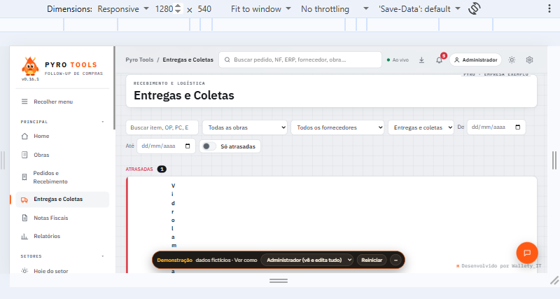
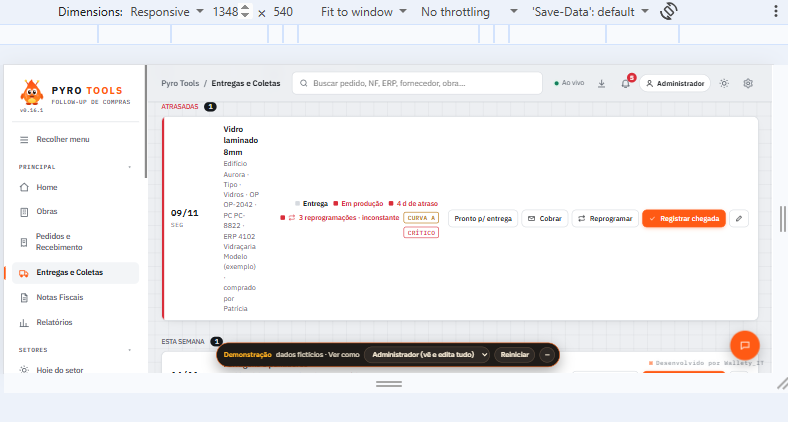

# PYRO-1 · Entregas e Coletas: nome do item quebra letra por letra em telas de 901px a 1344px de largura

| Campo | Valor |
| --- | --- |
| Tipo | Bug |
| Status | Aberto |
| Severity | Medium |
| Priority | Medium |
| Reportado por | Wesley Lemos |
| Data | 13/11/2026 |

## Environment

- Browsers: Chrome 157.0.8103.79 e Microsoft Edge 157.0.4341.57
- OS: Windows 10 Pro
- Pyro Tools: v0.16.1 (demonstração). O defeito também existe na versão em uso real, v0.18.0
- URL: https://pyro-tools-demo.web.app/#entregas
- Largura da janela: defeito ocorre de 901px a 1344px

## Preconditions

- Perfil "Administrador" selecionado em "Ver como"
- Ao menos uma entrega na lista

## Steps to Reproduce

1. Abrir https://pyro-tools-demo.web.app
2. No menu lateral, clicar em "Entregas e Coletas"
3. Pressionar F12 para abrir o DevTools
4. Pressionar Ctrl+Shift+M para ativar o modo de dispositivo
5. Na barra do topo, selecionar "Dimensions: Responsive" e digitar 1280 na largura
6. Observar o nome do item na primeira linha da lista de entregas

**Notas**

- Com largura abaixo de 901px ou acima de 1344px, o defeito não ocorre.
- O defeito ocorre com o menu lateral aberto e também com ele recolhido.
- O limite superior varia conforme o conteúdo da linha: 1317px em 12/11 e 1344px em 13/11.

## Expected Result

O nome do item e os detalhes (obra, fase, OP, PC, fornecedor) aparecem na horizontal e legíveis. Se o espaço for pequeno, o texto quebra entre palavras, nunca no meio de uma palavra.

## Actual Result

A coluna com o nome e os detalhes do item fica estreita demais, e o texto aparece com uma letra por linha, na vertical.

Exemplo: "Vidro laminado 8mm" aparece como V / i / d / r / o ...

A linha fica muito alta e o texto fica ilegível. A data, os status e os botões continuam aparecendo normalmente.

## Severity: Medium

O usuário consegue trabalhar e nenhum dado é perdido, mas o nome e os detalhes do item ficam ilegíveis em telas de 901px a 1344px de largura, faixa comum em notebooks e tablets.

Workaround: recolher o menu lateral não resolve.

## Evidence

Com defeito, em 1280px de largura:

Sem defeito, em 1345px de largura:

## Como foi encontrado

Percebi o defeito nos meus próprios testes do sistema. Ele voltou a aparecer em um print da tela, na preparação da versão de portfólio. Para este relatório, reproduzi o defeito na demonstração, medi a faixa de largura em que ele ocorre e testei em dois navegadores.
